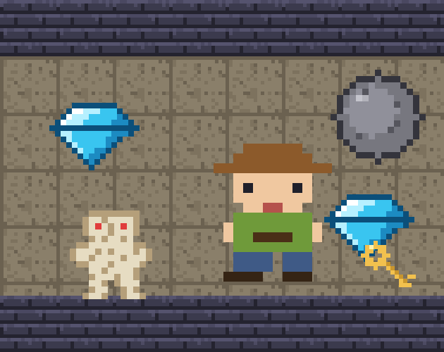

# Diamond Rush

Jogo 2D de aventura em grade feito em Unity 6 para o **Projeto Introdução ao Unity** (Insper, 2026), a partir do tutorial "Introdução Rápida". Estilo puzzle-aventura: colete todos os diamantes, empurre pedras, abra portas e fuja da ruína antes que o tempo acabe.

**Autor:** Esthefanny Sousa Farias

**Jogue no navegador (itch.io):** https://esthefannyf.itch.io/diamond-rush

## Como jogar

| Ação | Teclado | Controle (Xbox) |
|---|---|---|
| Mover | WASD / setas | Direcional / analógico esquerdo |
| Desfazer jogada | Z / Backspace | B |
| Reiniciar fase | R | Y |
| Pausar | ESC / P | Start |

- Colete **todos os diamantes** para abrir a saída.
- **Pedras** podem ser empurradas e tampam os **espinhos**.
- **Chaves** abrem portas. **Relógios** dão +10 s.
- **Cobras** patrulham sem parar, em tempo real; a **múmia** persegue o jogador quando ele chega perto.
- Cada fase tem tempo limite e você tem 3 vidas. Ao terminar, aparecem o tempo total e a pontuação.
- Se uma pedra travar o caminho, é só desfazer a jogada ou reiniciar a fase.

## Estrutura do código

- `Assets/Scripts/Core`: regras do jogo sem MonoBehaviour (`World`, `GameSession`, `Level`, `EnemyBehaviors`).
- `Assets/Scripts/Presentation`: visualização, entrada, áudio e estados (`WorldView`, `GridInput`, `GameController`, `GameStates`, `AudioFeedback`).
- `Assets/Scripts/UI`: HUD, painel de mensagens e menu.
- `Assets/Levels`: fases em arquivos de texto.
- `Assets/Editor`: ferramentas para montar as cenas e gerar a build WebGL.
- `Assets/PlayerMovement.cs` e `Assets/Scenes/SampleScene.unity`: resultado do tutorial.

Os inimigos se movem em tempo real mesmo com o jogador parado.

Padrões usados: Strategy (comportamento dos inimigos), Memento (desfazer), Observer (eventos da partida), State (jogando, pausado, mensagem) e separação entre lógica e visualização.

## Créditos

- Inspiração de gênero e mecânicas: o jogo mobile Diamond Rush (Gameloft). Nenhum sprite, som ou código dele foi usado.
- Tutorial base: "Introdução Rápida" da disciplina.
- Sprites: pixel art original de 16x16, criada para este projeto com auxílio de ferramenta de IA.
- Sons e música: gerados para este projeto pelo script `Tools/gerar_sons.py`.

